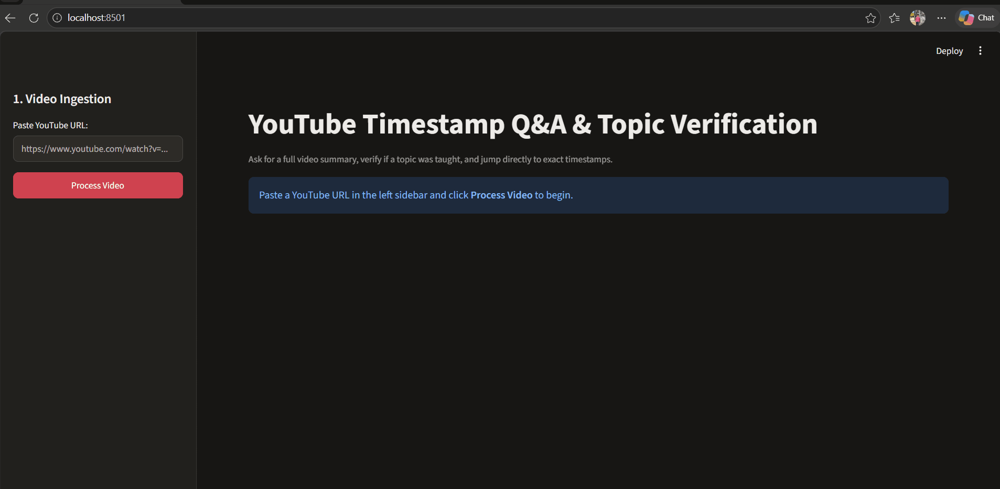
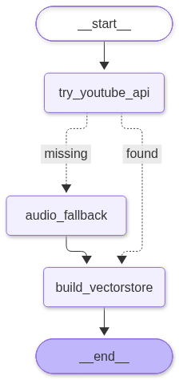
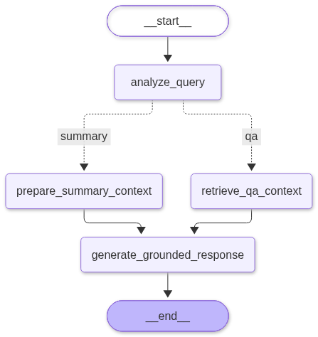

# 🎥 Timestamp-Aware YouTube Video Q&A & Verification Assistant

An end-to-end, strictly grounded Retrieval-Augmented Generation (RAG) application built with **LangGraph**, **Google Gemini**, **FAISS**, and **Streamlit**.

Given any YouTube URL, this assistant extracts or transcribes the video content, translates non-English audio/captions into English while preserving original language attribution, and lets users generate chronological summaries, ask multi-turn follow-up questions, verify whether specific concepts were taught, and jump directly to exact `[MM:SS]` video timestamps.

---

## 🎬 Live Demo

<!-- Replace 'assets/demo.gif' with your recorded GIF file path -->


---

## 🏗️ System Architecture & Step-by-Step Pipeline Execution

To prevent redundant compute and API latency during multi-turn conversations, the backend (`final_backend.py`) separates execution into **two distinct stateful LangGraph workflows**:

### Phase 1: One-Time Multilingual Ingestion Graph (`ingestion_app`)
*Executes **once** when a user submits a YouTube URL.*



1. **Video ID Extraction & Caption Check (`try_youtube_api` node):**
   * Parses the 11-character YouTube video ID from any standard link (`youtube.com`, `youtu.be`, or Shorts) and queries `youtube-transcript-api` for available caption tracks in any language.
   * If captions are found, it records the video's `original_language` (e.g., `"Hindi"`, `"English"`) and translates non-English captions into English while keeping exact `start_sec` timestamps intact.
2. **Conditional Routing (`route_transcript` decision edge):**
   * **Path A (`found`):** Skips audio downloading completely and jumps straight to chunking and vector indexing.
   * **Path B (`missing`):** Routes captionless or disabled-caption videos to the audio fallback pipeline.
3. **Audio Download & Gemini Transcription Fallback (`audio_fallback` node):**
   * Uses `yt-dlp` and `FFmpeg` to extract a lightweight `64kbps` `.mp3` audio track, uploads it to the Google GenAI File API, and uses `gemini-3.5-flash-lite` with a **Pydantic structured schema** (`AudioTranscriptionResult`) to detect the spoken language, transcribe, and translate the audio into timestamped English segments.
   * Automatically cleans up local `.mp3` and cloud-uploaded files in a `finally` block.
4. **Timestamp-Aware Chunking & FAISS Indexing (`build_vectorstore` node):**
   * Groups consecutive English segments into ~600-character LangChain `Document` chunks with a 1-segment boundary overlap so concepts split across boundaries remain searchable.
   * Embeds every chunk using `gemini-embedding-001` into an in-memory **FAISS** vector store while retaining `start_sec`, `timestamp` (`MM:SS`), and clickable `&t=Xs` YouTube URLs in `Document.metadata`.

---

### Phase 2: Repeatable Conversational Q&A & Verification Graph (`qa_app`)
*Executes **on every user message** against the cached FAISS index and chronological transcript chunks.*



1. **Conversational Query Rewriting & Intent Classification (`analyze_query` node):**
   * Inspects recent `chat_history` to resolve pronouns and follow-up references (e.g., turning *"Explain that second point again"* into a standalone search query).
   * Uses a Pydantic schema (`QueryAnalysis`) to classify user intent into either **`summary`** (broad overview) or **`qa`** (targeted question / follow-up).
2. **Intent-Based Context Routing (`route_intent` decision edge):**
   * **Summary Branch (`prepare_summary_context`):** Loads all chronological transcript chunks from the video so the summary covers the entire lecture from start to finish.
   * **Q&A Branch (`retrieve_qa_context`):** Performs semantic similarity search (`k=5`) over the FAISS vector store using the context-resolved standalone query.
3. **Strictly Grounded Response & Timestamp Verification (`generate_grounded_response` node):**
   * Passes the retrieved excerpts, `original_language`, and recent `chat_history` to `gemini-3.5-flash-lite` bound to the `AssistantResponse` Pydantic schema.
   * **Negative-Constraint Verification:** Enforces strict grounding—if a queried concept is absent from the video transcript, `found_in_video` is set to `False` and the assistant explicitly responds: *"This topic is not found in this video."*
   * **Clickable Deep Links:** Attaches verified `[MM:SS]` citations with direct `&t=Xs` URLs that cue the embedded Streamlit video player to the exact moment the topic is explained.

---

## ✨ Key Features

* **Dual-Graph Lifecycle Optimization:** Separates heavy one-time ingestion (`ingestion_app`) from low-latency conversational retrieval (`qa_app`) via Streamlit `st.session_state`.
* **Zero-Caption Resilience:** Handles videos without subtitles automatically via `yt-dlp` + `FFmpeg` + Gemini multimodal audio transcription.
* **Multilingual Support with English Standardization:** Translates non-English videos (Hindi, Kannada, Spanish, etc.) into English for uniform retrieval while displaying an original-language attribution banner.
* **Interactive Timestamp Navigation:** Clicking any `▶ [MM:SS]` citation button immediately jumps the embedded YouTube player to that exact timestamp.
* **Full LangSmith Observability:** Every graph transition and helper function (`fetch_youtube_captions`, `download_youtube_audio`, `gemini_audio_transcribe_and_translate`, `chunk_and_embed_faiss`) is instrumented with `@traceable` for end-to-end latency and trace inspection.

---

## 🛠️ Tech Stack

* **Orchestration & Tracing:** LangGraph, LangChain, LangSmith (`@traceable`)
* **LLM & Embeddings:** Google Gemini API (`gemini-3.5-flash-lite`, `gemini-embedding-001`) via `google-genai` & `langchain-google-genai`
* **Media & Audio Extraction:** `youtube-transcript-api`, `yt-dlp`, `FFmpeg`
* **Vector Search & Schema Validation:** FAISS (`faiss-cpu`), Pydantic v2
* **Frontend Interface:** Streamlit

---

## 📁 Project Structure

```text
├── app.py                   # Streamlit GUI (video player, session caching, interactive chat & timestamp jump buttons)
├── final_backend.py         # Complete LangGraph Phase 1 & Phase 2 workflows, Pydantic schemas, and @traceable helpers
├── requirements.txt         # Python dependencies
├── packages.txt             # System-level dependency (ffmpeg) for Linux/cloud environments
├── .gitignore               # Excludes .env, virtual environments, cache, and temporary audio files
├── assets/
│   ├── demo.gif                         # Screen recording of the running Streamlit application
│   ├── phase1_ingestion_workflow.png    # Architecture diagram for Phase 1 Ingestion Graph
│   └── phase2_qa_workflow.png           # Architecture diagram for Phase 2 Q&A Verification Graph
└── README.md
